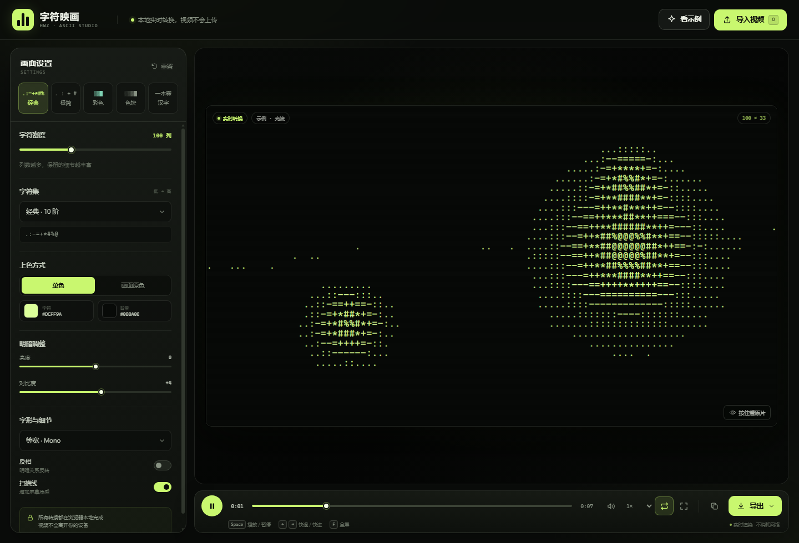

# 字符映画 · 视频转字符画

把一段视频，变成持续流动的字符画。所有画面采样、字符渲染与导出都在本机浏览器中完成，视频不会上传到任何服务器。



## 快速开始

1. 双击 **`启动字符画工坊.bat`**。
2. 浏览器会自动打开工具页面；保持黑色命令行窗口开启即可。
3. 点击「导入视频」，或直接把视频拖进窗口。
4. 在左侧调整密度、字符集和颜色；下方控制播放；右下角导出。

> 关闭命令行窗口即可停止本地服务。浏览器建议使用最新版 Edge 或 Chrome。

如果电脑默认浏览器没有自动打开，可手动访问命令行窗口中显示的地址，例如 `http://127.0.0.1:8765/`。

## 功能

### 实时字符画

- 视频逐帧采样，按明暗映射到字符，边播边生成连续字符画。
- 横向字符数可在 **40–320 列**之间调节，自动按视频比例计算行数。
- 字符网格超过一定规模时自动降低预览帧率，优先保证操作流畅。
- PNG 截图分辨率可选 **1080P / 2K / 4K**（长边 1920 / 2560 / 3840 px）。
- 5 种一键风格：经典、极简、彩色、色块、汉字。
- 7 种字符集：经典、细腻 70 阶、极简、色块、汉字、数字、自定义。
- 自定义字符集：输入任意字符，按从暗到亮的顺序排列。
- 单色 / 画面原色两种上色方式；字符色和背景色可自由选择。
- 亮度、对比度、反相、扫描线、等宽 / 宋体 / 黑体字形。
- 设置会自动保存在浏览器中，下次打开继续使用。

### 播放与查看

- 播放 / 暂停、拖动进度、快退快进、循环播放。
- 0.5× 到 2× 播放速度、音量与静音。
- 按住「按住看原片」可快速对比原始视频。
- 全屏查看，双击预览画面也可以进入全屏。
- 支持把视频直接拖进窗口。

### 导出

| 格式 | 内容 |
| --- | --- |
| **PNG** | 当前帧高清字符画，长边可选 1080P / 2K / 4K |
| **TXT** | 当前帧纯文本字符矩阵 |
| **ZIP** | 按帧编号的连续 TXT 序列，附 README 说明 |
| **HTML** | 内嵌全部字符帧的单文件动画网页，可离线播放 |
| **MP4** | 后台逐帧转换的标准视频，H.264 + AAC，支持 720p / 1080p / 1440p / 2160p（4K） |

- 视频转换在后台进行，关闭导出面板后可以继续操作界面。
- 转换期间预览画面会暂停刷新，避免与后台逐帧渲染抢占 CPU / GPU；完成后自动恢复。
- 右下角会显示转换进度，可随时取消；完成后自动下载。
- 输出使用 **Fast Start MP4**（`moov` 在 `mdat` 之前），带完整时长与索引，可在 Windows 自带媒体播放器中拖动进度。
- 转换分辨率为标准短边像素：1080p = 1920×1080，1440p = 2560×1440，2160p = 3840×2160。
- 视频转换为逐帧离线编码，不受实时录制性能影响；可设置 24 / 30 fps 和结束时间。
- 转换使用点击「开始转换」时的画面设置，之后调整预览设置不会影响已经开始的转换。
- **GPU 加速**：支持 WebGL2 的浏览器会使用实例化字形图集在 GPU 上绘制字符，避免每帧数万次 `fillText`；同时优先请求硬件 H.264 编码器。界面摘要和完成提示会显示「GPU 渲染 / 硬件编码优先」。
- 转换为**顺序解码**：播放静音源视频并在每个呈现帧暂停，不再逐帧 `seek` 回关键帧，长视频速度可提升数倍。
- 转换采用磁盘流式写入（OPFS）：编码数据直接写入浏览器本地磁盘，不再占用大量内存，**帧数不设上限**。
- 实际可转换长度仅受磁盘剩余空间、浏览器存储配额和源视频长度限制；极长视频仍建议先用较低画质试转。
- 不支持 OPFS 的旧浏览器会自动回退到内存模式，此时仍保留按画质区分的帧数上限。
- 不支持 WebGL2 的浏览器会自动回退到 Canvas2D 字符渲染，功能不受影响，只是高密度转换更慢。
- 导出 ZIP / HTML 时可设置起止时间和帧率（6–24 fps）。
- 文本与 HTML 只保存单色字符；PNG 和视频会保留当前颜色设置。

### 快捷键

| 按键 | 功能 |
| --- | --- |
| `Space` | 播放 / 暂停 |
| `←` / `→` | 快退 / 快进 5 秒 |
| `F` | 全屏 |
| `M` | 静音 |
| `L` | 循环开关 |
| `O` 或 `Ctrl+O` | 导入视频 |
| `Shift+S` | 导出当前帧 PNG |

## 视频格式

- 推荐 **MP4（H.264 + AAC）**，兼容性最好。
- 支持 **WebM、MOV、M4V、OGV**。
- MKV 是否能播放取决于浏览器内部编码支持。
- 若提示无法解码，可先用视频转换工具转为 H.264 MP4。

## 项目文件

```text
HWZ字符画转换工具/
├─ 启动字符画工坊.bat     启动本地服务并打开浏览器
├─ server.exe             轻量本地静态服务器（仅监听 127.0.0.1）
├─ index.html             工具页面
├─ styles.css             界面样式
├─ app.js                 字符渲染、播放、导出与后台转换逻辑
├─ ascii-gpu.js           WebGL2 实例化字符渲染器
├─ converter-worker.js    后台 MP4 编码 Worker
├─ vendor/
│  ├─ mp4-muxer.mjs       MP4 封装库
│  └─ mp4-muxer.LICENSE.txt
├─ assets/
│  ├─ demo.mp4            内置演示视频
│  └─ preview.png         界面预览图
├─ tools/
│  ├─ Server.cs           本地服务器源码
│  └─ build-server.bat    重新编译 server.exe
└─ README.md
```

## 为什么需要启动器

浏览器在 `file://` 页面里读取视频像素时，可能把视频判定为跨域资源，从而阻止字符采样；内置演示视频尤其会受影响。

`启动字符画工坊.bat` 会在本机 `127.0.0.1` 上启动一个只服务当前文件夹的小型 HTTP 服务，再打开浏览器。这样视频、画面采样、导出和后台 MP4 转换都能稳定工作，同时不经过外网。

如果直接双击 `index.html`：

- 自己导入的视频通常仍可实时预览（视频通过本地 Blob 读取）。
- 内置示例和后台 MP4 转换会提示改用启动器。
- 建议始终使用 `启动字符画工坊.bat`。

## 隐私说明

- 本地服务只绑定 `127.0.0.1`，不会监听局域网，也不会向外传输数据。
- 视频文件只存在于当前浏览器会话中。
- 导出的文件直接下载到你选择的位置。

## 常见问题

**点击「看示例」提示需要本地服务？**  
请通过 `启动字符画工坊.bat` 打开。直接双击 `index.html` 时浏览器会阻止读取内置示例视频的像素，但你自己导入的视频通常仍可使用。

**提示无法解码视频？**  
浏览器对编码比较挑剔。推荐使用 H.264 + AAC 的 MP4；MKV 等容器是否可播取决于浏览器内部的编码支持。

**转换出来的视频没有声音？**  
确认「包含视频声音（若有）」已勾选，并确认原视频本身带有音轨。没有音轨或浏览器无法解码音轨时，会自动输出无声视频。

**转换速度慢？**  
后台转换会逐帧重新采样和编码。当前版本已使用顺序解码 + GPU 字符渲染，320 列、3 分钟、1080p 的素材在支持硬件编码的机器上通常几分钟内完成。若仍然很慢，请确认导出摘要显示「GPU 渲染」；显示「CPU 渲染」时说明浏览器未启用 WebGL2，可更新显卡驱动或改用最新版 Edge / Chrome。4K 转换的数据量更大，建议先试 1080p，或把字符密度控制在 200 列以内。

**转换到一半失败 / 卡住？**

先看右下角错误提示。常见原因：
- 磁盘或浏览器存储配额不足：释放磁盘空间，或降低输出画质。
- 源视频过长 / 磁盘剩余空间不足：转换是流式写入磁盘的，输出文件需要相应空间。
- 切换标签页不会中断转换；关闭标签页会中断，浏览器会先弹出确认。
- 若提示编码器无响应，请重试并降低画质；仍失败可在开发者工具 Console 中查看具体错误。

**视频在播放器里不能拖动进度？**  
请使用当前版本的「生成字符画视频」。输出为标准 Fast Start MP4（H.264 + AAC），包含完整索引和时长，Windows 自带媒体播放器可以正常拖动。旧版本实时录制的 WebM / 分片 MP4 不在这个保证范围内。

**server.exe 被安全软件拦截？**  
它是一个只监听 `127.0.0.1`、仅用于读取当前文件夹静态文件的本地服务。你可以信任并放行，或双击 `tools/build-server.bat` 从附带的 `tools/Server.cs` 源码重新生成。

## 第三方组件

后台 MP4 封装使用 [mp4-muxer](https://github.com/Vanilagy/mp4-muxer) 5.2.2（MIT License），已内置于 `vendor/`，不依赖外部 CDN。许可证见 `vendor/mp4-muxer.LICENSE.txt`。

## 重新编译本地服务

仅在你修改了 `tools/Server.cs` 时需要：

1. 双击 `tools/build-server.bat`。
2. 重新生成 `server.exe`。

服务使用 Windows 自带的 .NET Framework C# 编译器，不依赖 Node.js、Python 或任何第三方运行库。
